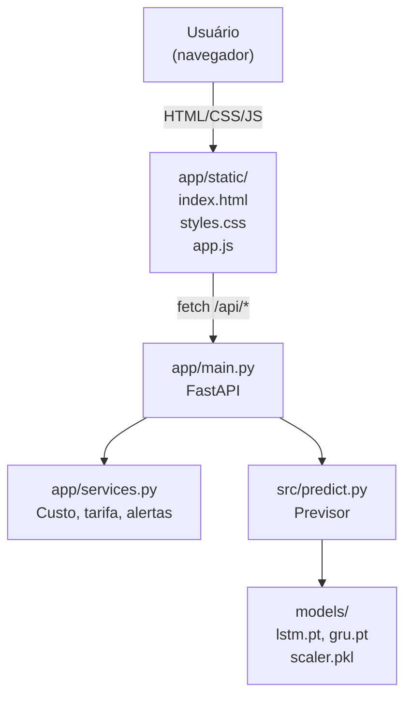

# Como o Sistema EnergyGreen Funciona — Passo a Passo

Guia simplificado que explica cada etapa do sistema de previsão de consumo de energia, desde os dados brutos até o dashboard interativo.

---

## 📌 Visão Geral

O EnergyGreen é um sistema que **prevê as próximas 24 horas** de consumo elétrico de uma residência com base nas **últimas 168 horas (7 dias)** de histórico. Ele usa redes neurais recorrentes (LSTM e GRU) treinadas em PyTorch e entrega os resultados em um dashboard web interativo.


---

## Etapa 1 — Obtenção dos Dados

**Arquivo:** `src/data.py`

O sistema baixa automaticamente o dataset **Individual Household Electric Power Consumption** do repositório UCI Machine Learning (id 235). São medições de consumo de uma residência em Sceaux (França), registradas **a cada minuto** durante ~4 anos (dez/2006 a nov/2010).

| Item | Valor |
|---|---|
| Total de registros (minutos) | 2.075.259 |
| Período coberto | 16/12/2006 → 26/11/2010 |
| Dados ausentes | 25.979 minutos (1,25%) |

**O que o arquivo contém (7 medições):**

| Coluna | O que mede |
|---|---|
| `Global_active_power` | Potência ativa média (kW) — **este é o alvo da previsão** |
| `Global_reactive_power` | Potência reativa (kW) |
| `Voltage` | Tensão (V) |
| `Global_intensity` | Corrente (A) |
| `Sub_metering_1` | Energia da cozinha (Wh) |
| `Sub_metering_2` | Energia da lavanderia (Wh) |
| `Sub_metering_3` | Energia do aquecedor/ar-condicionado (Wh) |

**Como executar:**
```bash
python -m src.data
```

---

## Etapa 2 — Limpeza e Preparação

**Arquivo:** `src/data.py`

Os dados brutos passam por um pipeline de limpeza:

1. **Parsing** — As colunas `Date` e `Time` são combinadas em um índice datetime. Valores marcados com `?` viram `NaN`.
2. **Reamostragem horária** — Os ~2 milhões de registros por minuto são agregados em **médias por hora**, resultando em **34.589 pontos horários**. Isso reduz ruído e torna o treinamento viável em CPU.
3. **Preenchimento de lacunas:**
   - Lacunas de **até 6 horas** → interpolação linear no tempo.
   - Lacunas **maiores** → preenchidas com o valor da **mesma hora da semana anterior** (preserva o padrão diário/semanal).
   - Total de horas preenchidas: **421**.

---

## Etapa 3 — Engenharia de Features

**Arquivo:** `src/data.py`

Além das 7 medições originais, o sistema cria **5 features extras** (totalizando **12 features**):

| Feature | Por quê? |
|---|---|
| `hour_sin`, `hour_cos` | Codificação cíclica da hora do dia (a rede entende que 23h e 0h são vizinhas) |
| `dow_sin`, `dow_cos` | Codificação cíclica do dia da semana |
| `is_weekend` | Flag binária de fim de semana |

> **Por que codificação cíclica?** Sem ela, a rede entenderia que a hora 23 está "longe" da hora 0 (diferença de 23), quando na realidade são vizinhas. Seno e cosseno resolvem isso representando o tempo como posição num círculo.

---

## Etapa 4 — Divisão dos Dados e Normalização

**Arquivo:** `src/data.py`

### Divisão cronológica (70 / 15 / 15)

A série é dividida **na ordem do tempo**, sem embaralhar — fundamental para evitar vazamento de dados do futuro:

| Conjunto | Período | Horas | Uso |
|---|---|---|---|
| **Treino** | dez/2006 → set/2009 | 24.212 | Aprender os padrões |
| **Validação** | set/2009 → abr/2010 | 5.188 | Ajustar hiperparâmetros e early stopping |
| **Teste** | abr/2010 → nov/2010 | 5.189 | Avaliar o desempenho final (dados nunca vistos) |

### Normalização

- O `StandardScaler` é ajustado **somente nos dados de treino** (média e desvio padrão).
- A mesma transformação é aplicada em validação e teste.
- As previsões são **desnormalizadas** antes de calcular qualquer métrica.

### Janelas deslizantes

Cada exemplo para a rede neural é construído assim:

```
Entrada (X):  168 horas × 12 features  →  "Veja o que aconteceu nos últimos 7 dias"
Saída   (y):  24 horas de consumo       →  "Preveja as próximas 24 horas"
```

As janelas são criadas **dentro de cada partição**, garantindo que nenhuma janela de teste enxerga dados de treino.

| Conjunto | Janelas geradas |
|---|---|
| Treino | 4.805 (passo 5 entre janelas, para caber em memória) |
| Validação | 4.997 (passo 1 — todas as janelas) |
| Teste | 4.998 (passo 1 — todas as janelas) |

---

## Etapa 5 — Treinamento dos Modelos

**Arquivos:** `src/models.py` (arquiteturas) + `src/train.py` (loop de treino)

### Os três modelos

| Modelo | O que faz | Parâmetros |
|---|---|---|
| **Baseline sazonal** | Repete as últimas 24h como previsão (sem aprendizado) | 0 |
| **LSTMForecaster** | Rede LSTM com 2 camadas de 64 unidades + dropout 0,2 → camada linear que gera as 24h | 54.808 |
| **GRUForecaster** | Rede GRU com 2 camadas de 64 unidades + dropout 0,2 → camada linear que gera as 24h | 41.496 |

> **Multi-passo direto:** As 24 horas são previstas de uma só vez (não uma de cada vez). Isso evita que erros se acumulem ao longo do horizonte.

### Configuração do treinamento

- **Otimizador:** Adam (learning rate 1e-3)
- **Função de perda:** MSE (erro quadrático médio)
- **Lote (batch):** 64 janelas
- **Épocas:** até 30 (com early stopping)
- **Early stopping:** paciência de 5 épocas na perda de validação; restaura os melhores pesos
- **Redução de learning rate:** `ReduceLROnPlateau` (fator 0,5, paciência 2)
- **Clipping de gradiente:** norma máxima de 1,0
- **Semente fixa:** 42 (reprodutibilidade)

### Resultado do treinamento

| Modelo | Épocas executadas | Melhor época | Tempo |
|---|---|---|---|
| LSTM | 11 | 6 | ~2 min |
| GRU | 15 | 10 | ~8 min |

**Artefatos gerados em `models/`:**
- `lstm.pt` — pesos da LSTM
- `gru.pt` — pesos da GRU
- `scaler.pkl` — normalizador ajustado no treino
- `metrics.json` — todas as métricas e hiperparâmetros

**Como executar:**
```bash
python -m src.train
```

---

## Etapa 6 — Avaliação e Métricas

**Arquivo:** `src/evaluate.py`

### Métricas no conjunto de teste (escala original, em kW)

| Modelo | MAE (kW) | RMSE (kW) | WAPE | R² |
|---|---|---|---|---|
| **LSTM** | **0,4260** | **0,5916** | **45,1%** | **0,305** |
| GRU | 0,4339 | 0,5940 | 45,9% | 0,300 |
| Baseline | 0,4969 | 0,7441 | 52,6% | −0,099 |

### O que cada métrica significa

| Métrica | Interpretação |
|---|---|
| **MAE** | "Em média, erramos X kW por hora" |
| **RMSE** | Penaliza mais os erros grandes (picos); importante para planejamento de demanda |
| **WAPE** | Erro relativo agregado: "erramos X% do consumo total" |
| **R²** | Fração da variância explicada (0 = prever a média; 1 = perfeito; negativo = pior que a média) |

> **Por que não usar MAPE?** Nas madrugadas o consumo é muito baixo (~0,2 kW), e qualquer pequeno erro em kW gera um percentual enorme. O WAPE responde à mesma pergunta sem esse problema.

### Principais achados

- A **LSTM reduz o MAE em 14,3%** e o RMSE em 20,5% em relação ao baseline.
- O baseline tem **R² negativo** — repetir o dia anterior é pior que prever a média global.
- O erro é **mínimo na madrugada** (~0,18 kW às 4h) e **máximo à noite** (~0,61 kW às 20h).
- Os modelos **subestimam picos**: quando o consumo real supera 1,92 kW, o erro da LSTM sobe para 1,03 kW.

**Como executar:**
```bash
python -m src.evaluate
```
Gera figuras em `reports/figures/`.

---

## Etapa 7 — Aplicação Web (Dashboard)

**Arquivos:** `app/main.py` (API FastAPI) + `app/services.py` (lógica de negócio) + `app/static/` (frontend)

### Arquitetura



### Como iniciar

```bash
uvicorn app.main:app --reload
```
Acesse **http://localhost:8000**

### Funcionalidades do Dashboard

#### 1. Entrada de dados
- **Arraste um CSV** para a área indicada, ou clique em **"Usar dados de exemplo"** (período de teste).
- Formatos aceitos: CSV bruto da UCI ou horário com `datetime` + `Global_active_power`.
- Mínimo de 168 horas de histórico.

#### 2. Cartões resumo
Exibem o consumo previsto (kWh), pico previsto e horário, custo estimado e variação contra as 24h anteriores. Reagem a toda interação.

#### 3. Máquina do tempo
- Escolha um dia pelo **controle deslizante**, **seletor de data** ou **setas ◀ ▶** (teclado ← →).
- O gráfico mostra as 168h de entrada + previsão das 24h seguintes + baseline.
- **"Revelar o real"** sobrepõe o consumo que realmente aconteceu, com MAE/RMSE/WAPE do dia.
- **"Reproduzir"** avança dia a dia automaticamente.
- **"Ir para o futuro"** prevê as 24h após o fim da série carregada.
- Alterne entre **LSTM** e **GRU**.

#### 4. Simulador de custo e tarifa
- Configure: preço do kWh, tarifa de ponta, faixa de ponta.
- Controle de **deslocamento de carga** (mover X% do consumo para fora da ponta).
- Gráfico de custo por hora com destaque para horário de ponta.

#### 5. Alertas de pico e desperdício
- **Arraste a linha tracejada** no gráfico (ou digite o limite) para definir o limiar.
- Lista as horas previstas acima do limite.
- Com o real revelado, mostra anomalias (consumo real muito acima do previsto).

#### 6. Tabela hora a hora
- Previsto, baseline, real, erro e custo para cada hora.
- Ordenável por qualquer coluna.
- **Exportar CSV** (separador `;`, vírgula decimal — abre direto no Excel em português).

#### 7. Desempenho dos modelos
Métricas de teste, erro por horizonte (h+1 a h+24) e curvas de treino/validação.

### Endpoints da API

| Método | Rota | O que faz |
|---|---|---|
| `POST` | `/api/upload` | Recebe um CSV e retorna a série processada |
| `GET` | `/api/exemplo` | Carrega os dados de exemplo (período de teste) |
| `GET` | `/api/serie` | Retorna a série carregada em sessão |
| `POST` | `/api/prever` | Executa a previsão para um dado dia |
| `POST` | `/api/custo` | Simula custo e tarifa sobre uma previsão |
| `POST` | `/api/alertas` | Retorna alertas de pico e anomalias |
| `GET` | `/api/desempenho` | Métricas de teste e curvas de treino |

Contrato completo em `docs/API.md`. Erros são retornados como `{"detail": "mensagem em português"}`.

---

## Resumo da Estrutura de Arquivos

```
trabalho_ia/
├── src/
│   ├── data.py          # Download, limpeza, features, divisão, janelas
│   ├── models.py        # Arquiteturas LSTM, GRU e baseline
│   ├── train.py         # Loop de treino com early stopping
│   ├── evaluate.py      # Métricas, gráficos, análise de picos
│   └── predict.py       # Previsor: carrega modelos e prevê
├── app/
│   ├── main.py          # API FastAPI + arquivos estáticos
│   ├── services.py      # Lógica de custo/tarifa e alertas
│   └── static/          # Dashboard (HTML, CSS, JS + Plotly.js)
├── models/              # Pesos treinados, scaler e métricas
├── tests/               # Testes automatizados (pytest)
├── notebooks/           # Notebook com o experimento completo
├── reports/figures/     # Gráficos gerados pela avaliação
├── docs/                # Documentação (API, Plano, Enunciado)
└── requirements.txt     # Dependências Python
```

---

## Reprodução Completa (Passo a Passo)

```powershell
# 1. Criar e ativar ambiente virtual
python -m venv .venv
.\.venv\Scripts\Activate.ps1

# 2. Instalar PyTorch (CPU)
pip install torch==2.15.0 --index-url https://download.pytorch.org/whl/cpu

# 3. Instalar demais dependências
pip install -r requirements.txt

# 4. Baixar e preparar os dados
python -m src.data

# 5. Treinar os modelos (~10 min em CPU)
python -m src.train

# 6. Avaliar e gerar gráficos
python -m src.evaluate

# 7. Rodar os testes
pytest

# 8. Iniciar o dashboard
uvicorn app.main:app --reload
# Acesse http://localhost:8000
```
